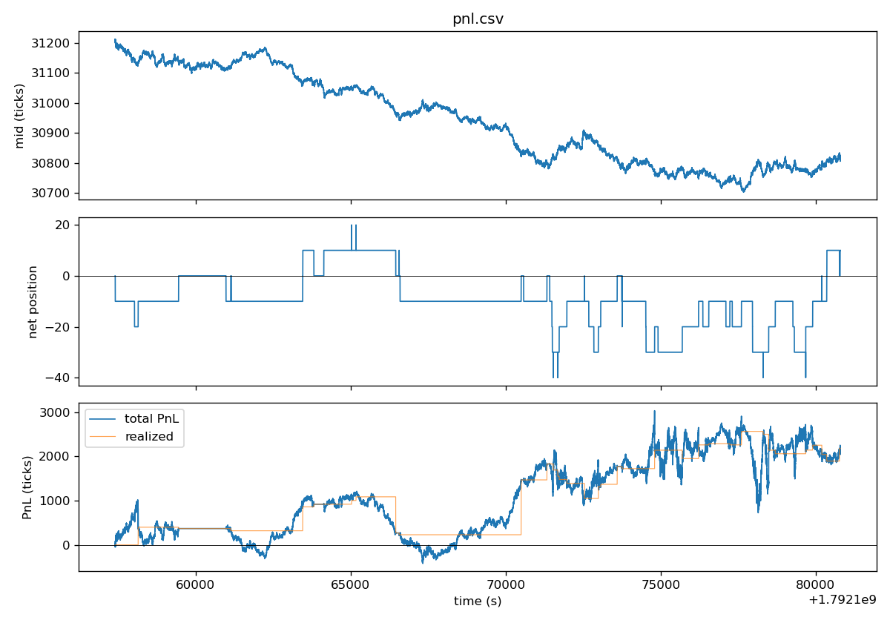

# lowlat-mm

A modular C++20 prototype of an event-driven market-making and execution engine,
built for learning and as a portfolio piece. The goal is *not* a production
HFT system; it is a clean educational implementation of the patterns you would
find in one (order book, OMS, risk gate, exchange simulator, replay backtest),
with realistic boundaries between modules and reasonable defaults.

The codebase is small enough to read in a sitting and structured to be
extended (more strategies, deeper book, real feed plug-ins) without rewriting
the core.

## Architecture

```
                    ┌──────────────────┐
                    │  CSV feed reader │
                    └────────┬─────────┘
                             │ TopOfBookEvent
                             ▼
┌────────────┐   md   ┌────────────────┐   new/cancel    ┌──────────┐
│  Strategy  │◀──────│  BacktestDriver │────────────────▶│   OMS    │
│ (MarketMkr)│       │   (event loop)  │                 └────┬─────┘
└─────┬──────┘       │  + EventBus     │                      │
      │ submit/cancel│                 │◀─── ack/fill ────────┤
      ▼              │                 │                      ▼
   ┌──────┐          │                 │              ┌───────────────┐
   │ Risk │◀─────────┤                 │              │   Exchange    │
   └──────┘          └────────┬────────┘              │   Simulator   │
                              │ apply_top             └───────────────┘
                              ▼
                       ┌─────────────┐
                       │  OrderBook  │
                       └─────────────┘
```

Events flow on a single timestamp-ordered priority queue (`EventBus`). The
driver pumps the queue, dispatching each event to the right component. The
OMS emits `NewOrderEvent` / `CancelOrderEvent` which the driver re-schedules
with strategy→exchange latency; the simulator emits `AckEvent` / `FillEvent`
which the driver re-schedules with exchange→strategy latency. This single
queue plus pure dispatch keeps the backtest fully deterministic for a given
input.

Events are a `std::variant` rather than a polymorphic hierarchy: the set of
event types is closed and known at compile time, so `std::visit` gives both
better cache locality and explicit handling at every call site.

## Modules

| Folder        | Responsibility                                                   |
|---------------|------------------------------------------------------------------|
| `core/`       | Numeric types (tick-int prices), event variant, bus, logger      |
| `market_data/`| CSV feed reader and symbol interning                             |
| `orderbook/`  | Top-of-book + depth book (std::map for clarity)                  |
| `execution/`  | OMS: order state machine, fill handling, position tracking       |
| `risk/`       | Pre-trade checks (max position/order/open qty), kill switch, drawdown |
| `simulator/`  | Exchange simulator: ack latency, marketable fills, passive fills |
| `strategy/`   | Base interface + inventory-aware market maker                    |
| `backtest/`   | Driver, PnL/inventory time series, trade blotter                 |
| `apps/`       | `run_backtest` CLI                                               |
| `tests/`      | Catch2 unit tests across all modules                             |

## Why this exists

Because reading "how does an exchange work" articles is no substitute for
having a small, working, modifiable implementation. The interesting parts
of trading-systems engineering (event ordering, order state machines,
fill assumptions, latency modelling) only really click once you can change
something and see it break.

The same code structure also serves as a fair starting point for a real
research engine: a colocated feed handler can replace the CSV reader; a
real broker connector can replace the simulator; the strategy and risk
layers don't need to change.

## Build

Requirements:
- C++20 compiler (g++ 11+ or clang++ 13+)
- CMake 3.16+
- POSIX shell (macOS / Linux)

```bash
cmake -S . -B build -DCMAKE_BUILD_TYPE=Release
cmake --build build -j
```

This produces:
- `build/run_backtest`: the CLI
- `build/unit_tests`: Catch2 test binary
- `build/liblowlat_mm_core.a`: the engine static library

## Run

The backtest runs on real CME E-mini S&P 500 (ES) top of book from
[Databento](https://databento.com). Market data is licensed, so the feed is
not in the repo; pull it yourself with your own API key (one day costs about
US$1.20):

```bash
pip install databento
export DATABENTO_API_KEY=...
python3 tools/databento_feed.py --date 2026-10-16 --symbol ESZ6
./build/run_backtest data/es.ini data/es_feed.csv
python3 tools/plot_pnl.py pnl.csv --out docs/pnl_es.png \
    --title "ESZ6, 16 Oct 2026, regular hours" --tick-size 0.25 --tick-value 12.5
```

`tools/databento_feed.py` pulls GLBX.MDP3 `mbp-1` for one contract over
regular hours (13:30 to 20:00 UTC), prints the Databento cost first and stops
if it is over US$10. It writes `data/es_feed.csv` in the engine's format
(`ts_ns,symbol,bid_px,bid_sz,ask_px,ask_sz`, prices in 0.25 ticks), one row
per top-of-book change, skipping rows with a missing or crossed side. Without
`--date` it takes the last weekday before today.

`data/es.ini` is `data/default.ini` with `tick_size = 0.25`. One ES tick is
US$12.50 per contract.

Optional outputs (configured in the `.ini`): a PnL/inventory time series
(`pnl.csv`) and a trade blotter (`trades.csv`).

## Sample output

> **Correction pending re-run.** The figures below were produced before a fix to the
> position accounting in `execution/OMS.cpp`: partly covering a short reset the entry
> price to the cover price, and a flip from short to long kept the old short entry.
> Both distort realised and unrealised PnL whenever the book is short, which it was for
> most of this session. The fill count and order count are unaffected; the PnL and
> drawdown need a re-run on the same feed.

ESZ6 (the front month) on Friday 16 October 2026, regular hours. The pull
cost US$1.19 and gave 8,907,105 `mbp-1` records, of which 8,406,677 change
the top of book. With `data/es.ini`:

```
# loaded 8406677 md events for symbol ESZ6

=== Backtest summary ===
symbol              : ESZ6
md events           : 8406677
orders submitted    : 556508
fills               : 77
ending position     : 10
last mid (ticks)    : 30812
realized PnL        : 546.0417  (2184.1667 ticks)
unrealized PnL      : -20.0000  (-80.0000 ticks)
total PnL           : 526.0417  (2104.1667 ticks)
max drawdown        : 577.0833  (2308.3333 ticks)
kill switch tripped : no
```

PnL is in ticks times contracts (the first figure is ticks times
`tick_size`, i.e. index points times contracts). At US$12.50 a tick, total
PnL is about US$26,300 and the max drawdown about US$28,900. The run took
about 20 minutes on an 8 GB laptop, because the engine holds the whole day
in memory.



Read this number with care:

- **Fills are on touch with no queue position**, so PnL is optimistic. A
  resting order fills as soon as the market reaches its price, as if it were
  first in the queue. That day the touch held a median of about 25 contracts
  on each side, all ahead of a new order, so many of these fills would not
  happen.
- **Most of the gain is direction, not spread.** ES fell about 100 points
  that day and the strategy was net short for most of it (see the position
  panel). On a day that rallied the same way, the result would likely flip.
- **It requotes far too often.** 556,508 orders for 77 fills, because it
  requotes on nearly every top-of-book change. A real exchange's messaging
  limits would not allow that.
- One day, one contract, no fees.

## Tests

```bash
./build/unit_tests           # 32 cases, 131 assertions
ctest --test-dir build       # equivalent through CTest
```

Coverage includes order book updates, OMS state transitions and PnL
attribution, risk gate rejections (max position/order/open qty/drawdown,
kill switch), simulator fill rules under both passive-fill modes, and
strategy behaviour (no quotes on crossed/one-sided books, symmetric
quoting, inventory skew direction, max-position side suppression, and
cancel-timestamp propagation on both `cancel_all()` routes).

## Configuration

`data/default.ini` is a flat key=value file. Notable knobs:

```ini
# Latency model (nanoseconds)
strategy_to_exchange_latency_ns = 100000
exchange_to_strategy_latency_ns = 100000
ack_latency_ns                  = 50000
fill_latency_ns                 = 50000

# Passive fill rule (see Limitations)
fill_on_touch = true

# Risk
max_position       = 200
max_order_size     = 100
max_open_qty       = 500
max_drawdown_ticks = 1e12

# Strategy
half_spread_ticks = 2
min_spread_ticks  = 1
quote_size        = 10
inv_skew          = 0.05
requote_thresh    = 1
```

## Queue-aware replay (OCaml) and markouts (kdb+/q)

`ocaml/` is a second implementation of the backtest. With the C++ fill rules it
reproduces `run_backtest`'s fill blotter byte for byte (`ocaml/crosscheck.sh`: every
config in `data/`, three feeds each), and it adds two fill rules that track queue
position from the exchange's trade prints, so a resting order fills only once the
volume ahead of it has traded. It also contains a price-time matching engine tested
against a naive reference book with QCheck. See [ocaml/README.md](ocaml/README.md).

`analytics/markouts.q` measures each fill's markout (side × (mid h later − fill
price)) at 0 ms to 5 minutes with an as-of join, plus the worst and best mid over the
following minute with a window join; `analytics/markouts.py` is the same table in
pandas. Run it on blotters from different fill rules to see how much of the touch
rule's PnL is adverse selection:

```bash
q analytics/markouts.q -feed data/es_feed.csv -fills trades.csv
python3 analytics/markouts.py --feed data/es_feed.csv --fills trades.csv
```

## Limitations and assumptions

This is an educational prototype. Its limits:

1. **Top-of-book only.** The feed format is `(bid_px, bid_sz, ask_px, ask_sz)`.
   Depth, queue position, and hidden liquidity are not modelled. The
   `OrderBook` class supports `apply_level()` for L2 updates, so plugging in
   a real L2 feed is mechanical, but the simulator currently uses only ToB.

2. **No trade prints in the C++ engine.** A real exchange feed includes
   prints showing incoming aggressors. The C++ simulator infers fills from
   quote movement. `tools/databento_feed.py --trades-out` writes the prints,
   and the OCaml replay in `ocaml/` uses them.

3. **Passive fill model.** Two settings:
   - `fill_on_touch = true` (default): a resting buy at p fills when
     `best_ask ≤ p`. Realistic for an order improving the visible book
     (queue-priority winner). Optimistic for an order at the touch.
   - `fill_on_touch = false`: strict trade-through (`best_ask < p`).
     Conservative.
   On a TOB feed without prints, both rules under-fill an MM that quotes
   *inside* the visible market, because the strategy will typically cancel
   and requote as the mid moves before the market catches up to the old
   quote. This is why so few quotes fill on the ES run (77 from 556,508
   orders): the only way the simulated MM gets filled is when the market trades
   *to or through* an old quote it hasn't yet cancelled, which is by
   definition adverse selection.

4. **Latency is fixed.** Real latency has jitter, queueing, and outliers.
   The model here adds a constant offset on each leg.

5. **Single-threaded, single-symbol.** The architecture is structured so
   multi-symbol is a small change (the OMS, risk, and book are already
   keyed by `SymbolId`); the strategy and runner currently assume one.

6. **No fees, no rebates, no borrow/funding.** PnL is purely
   price-difference on filled qty. Add a fee model in `OMS::on_fill`.

7. **No queue-position model in the C++ engine.** A real MM's edge is
   heavily about how far back in the queue you are at each price level. The
   C++ simulator assumes infinite liquidity at our limit price (full fill on
   touch, no partials). `ocaml/` replays the same strategy with queue
   position tracked from trade prints and partial fills.

8. **The "low latency" in the project name is aspirational.** The hot
   path uses `std::map`, `std::unordered_map`, and `std::variant`, which
   is fine for a backtest but not appropriate for a real trading-loop
   binary. The patterns are right; the data structures would need
   replacing for a production system.

## Future work

Roughly in order of value-for-effort:

1. **Queue-aware fills in C++.** Port the two queue rules from
   `ocaml/lib/exchange.ml` into `ExchangeSimulator`, fed by `TradeEvent`s.
2. **Multiple strategies / multiple symbols.** Driver already keys
   everything by `SymbolId`; mostly a matter of registering N strategies.
3. **Latency jitter.** Replace constant latency with a `std::function<Timestamp()>`
   distribution.
4. **Linear-time risk checks.** `RiskManager::check_new_order` scans every
   order the OMS has ever seen, which makes a full session quadratic; the
   OCaml OMS keeps live orders in their own table and runs about a hundred
   times faster on the same feed.
5. **Real feed plug-in.** Replace `CsvFeedReader` with a Databento or LOBSTER
   reader; the rest of the pipeline doesn't change.
6. **Better data structures on the hot path.** Replace `std::map` with
   tick-indexed arrays; replace `std::variant` dispatch with a function
   table if profiling shows it matters.
7. **More strategies.** Stoikov-style optimal market making, simple
   stat-arb, momentum execution.

## Repository layout

```
.
├── .gitignore
├── CMakeLists.txt
├── LICENSE
├── README.md
├── analytics/
│   ├── markouts.q                  # fill markouts with aj / wj (kdb+/q)
│   └── markouts.py                 # the same in pandas
├── apps/
│   └── run_backtest.cpp            # CLI entry point
├── backtest/
│   ├── BacktestDriver.cpp          # event loop, PnL series, blotter
│   └── BacktestDriver.hpp
├── core/
│   ├── Config.hpp                  # flat key=value .ini reader
│   ├── EventBus.hpp                # timestamp-ordered priority queue
│   ├── Events.cpp
│   ├── Events.hpp                  # std::variant event set
│   ├── Logger.hpp
│   └── Types.hpp                   # tick-int prices, ids, timestamps
├── data/
│   ├── default.ini                 # baseline config
│   ├── aggressive.ini              # tighter quoting variants
│   ├── patient.ini
│   ├── short_patient.ini
│   ├── v_patient.ini
│   ├── tight.ini
│   ├── wide.ini
│   ├── debug.ini                   # trace-level logging
│   └── es.ini                      # CME ES (0.25 tick)
├── docs/
│   ├── architecture.md             # extended design notes
│   └── pnl_es.png                  # PnL chart from the ES run
├── execution/
│   ├── OMS.cpp                     # order state machine, position, PnL
│   └── OMS.hpp
├── market_data/
│   ├── CsvFeedReader.cpp           # CSV reader, symbol interning
│   └── CsvFeedReader.hpp
├── ocaml/                          # lobsim: matching engine, queue-aware replay (see its README)
│   ├── lib/                        # engine, OMS, risk, exchange fill rules, market maker, driver
│   ├── bin/                        # lobsim-replay, lobsim-bench, lobsim-gen-feed
│   ├── test/                       # QCheck properties, fill-rule scenarios
│   └── crosscheck.sh               # byte-for-byte comparison with run_backtest
├── orderbook/
│   ├── OrderBook.cpp               # top of book + depth
│   └── OrderBook.hpp
├── risk/
│   ├── RiskManager.cpp             # pre-trade gate, kill switch
│   └── RiskManager.hpp
├── simulator/
│   ├── ExchangeSimulator.cpp       # ack latency, fill rules
│   └── ExchangeSimulator.hpp
├── strategy/
│   ├── MarketMaker.cpp             # inventory-aware market maker
│   ├── MarketMaker.hpp
│   └── Strategy.hpp                # base interface
├── tests/
│   ├── test_main.cpp               # Catch2 main
│   ├── test_oms.cpp
│   ├── test_orderbook.cpp
│   ├── test_risk.cpp
│   ├── test_simulator.cpp
│   └── test_strategy.cpp
├── third_party/
│   └── catch.hpp                   # vendored single-header Catch2 v2.13.10
└── tools/
    ├── databento_feed.py           # Databento ES pull -> data/es_feed.csv (+ trade prints)
    └── plot_pnl.py                 # pnl.csv -> chart
```

## Third-party

`third_party/catch.hpp` is the vendored single-header
[Catch2](https://github.com/catchorg/Catch2) v2.13.10 test framework, used
unmodified under the Boost Software License 1.0. Everything else in this
repository is covered by [`LICENSE`](LICENSE) (MIT).

---

Nicholas Hong | Built for educational and research purposes. Not financial advice.
